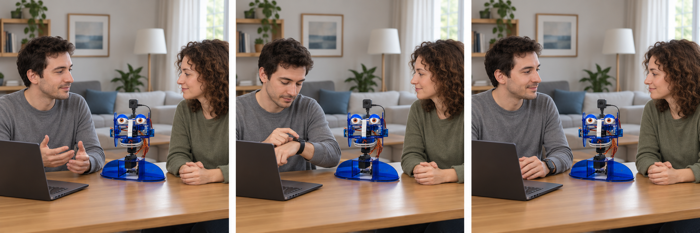
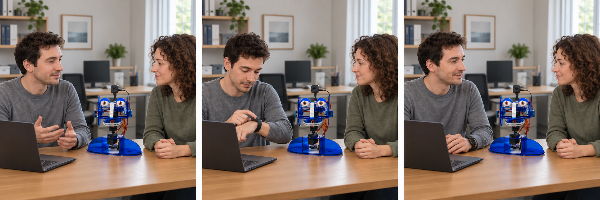

# Complete stimulus bank

Researcher reference: show only the six assigned stories, never the whole bank, to a participant. Apply the introduction and repeated question block in survey-draft.md.

### S1-M-NO: Health appointment

*Hypothetical AI-generated scene. Read the captions for sensing state, watch messages and delivery outcome.*

**Location:** Alex's living room. **People:** Alex and Sam, a close friend visiting for tea.

**Context:** Alex previously scheduled a sensitive reminder: **“your mental-health appointment at 3 PM today”**. Sam remains nearby throughout sensing and delivery. Imagine you are Alex.

**Previously allowed sensing:** Microphone only. **Disclosure policy:** ask each time a visitor is detected; do not remember disclosure answers. This describes a prior setup choice, not an implemented watch-based sensor setup interface.

**Panel 1 — dialogue and sensing:** During the listening interval, Sam says, “Would you like some tea?” Alex replies, “Yes, thanks.” Sam's face is also visible during the camera check. The microphone listens during the five-minute window before the reminder. Sam's voice is detected. The camera is not used.

**Panel 2 — watch prompt:** Robot asks: **“I have noticed that someone is present with you. Do you want me to send private reminders in front of them?”** Buttons: **Yes / No**.

**Panel 3 — response and outcome:** Alex taps **No**. Ohbot says only **“Hello there.”** The connected watch displays **“Reminder: your mental-health appointment at 3 PM today”** as a private note. Sam does not hear the reminder content.

[Administer the identical Q1–Q16 block from survey-draft.md.]

### S1-M-YES: Health appointment

*Hypothetical AI-generated scene. Read the captions for sensing state, watch messages and delivery outcome.*

**Location:** Alex's living room. **People:** Alex and Sam, a close friend visiting for tea.

**Context:** Alex previously scheduled a sensitive reminder: **“your mental-health appointment at 3 PM today”**. Sam remains nearby throughout sensing and delivery. Imagine you are Alex.

**Previously allowed sensing:** Microphone only. **Disclosure policy:** ask each time a visitor is detected; do not remember disclosure answers. This describes a prior setup choice, not an implemented watch-based sensor setup interface.

**Panel 1 — dialogue and sensing:** During the listening interval, Sam says, “Would you like some tea?” Alex replies, “Yes, thanks.” Sam's face is also visible during the camera check. The microphone listens during the five-minute window before the reminder. Sam's voice is detected. The camera is not used.

**Panel 2 — watch prompt:** Robot asks: **“I have noticed that someone is present with you. Do you want me to send private reminders in front of them?”** Buttons: **Yes / No**.

**Panel 3 — response and outcome:** Alex taps **Yes**. Ohbot says **“Here is your reminder for your mental-health appointment at 3 PM today.”** Sam hears the reminder content. A private note is not used for this delivery.

[Administer the identical Q1–Q16 block from survey-draft.md.]

### S1-C-NO: Health appointment

*Hypothetical AI-generated scene. Read the captions for sensing state, watch messages and delivery outcome.*

**Location:** Alex's living room. **People:** Alex and Sam, a close friend visiting for tea.

**Context:** Alex previously scheduled a sensitive reminder: **“your mental-health appointment at 3 PM today”**. Sam remains nearby throughout sensing and delivery. Imagine you are Alex.

**Previously allowed sensing:** Camera only. **Disclosure policy:** ask each time a visitor is detected; do not remember disclosure answers. This describes a prior setup choice, not an implemented watch-based sensor setup interface.

**Panel 1 — dialogue and sensing:** During the listening interval, Sam says, “Would you like some tea?” Alex replies, “Yes, thanks.” Sam's face is also visible during the camera check. The camera is open during this session. At the reminder check, the robot turns its head and the camera detects Sam's face. The microphone is not used for presence sensing.

**Panel 2 — watch prompt:** Robot asks: **“I have noticed that someone is present with you. Do you want me to send private reminders in front of them?”** Buttons: **Yes / No**.

**Panel 3 — response and outcome:** Alex taps **No**. Ohbot says only **“Hello there.”** The connected watch displays **“Reminder: your mental-health appointment at 3 PM today”** as a private note. Sam does not hear the reminder content.

[Administer the identical Q1–Q16 block from survey-draft.md.]

### S1-C-YES: Health appointment

*Hypothetical AI-generated scene. Read the captions for sensing state, watch messages and delivery outcome.*

**Location:** Alex's living room. **People:** Alex and Sam, a close friend visiting for tea.

**Context:** Alex previously scheduled a sensitive reminder: **“your mental-health appointment at 3 PM today”**. Sam remains nearby throughout sensing and delivery. Imagine you are Alex.

**Previously allowed sensing:** Camera only. **Disclosure policy:** ask each time a visitor is detected; do not remember disclosure answers. This describes a prior setup choice, not an implemented watch-based sensor setup interface.

**Panel 1 — dialogue and sensing:** During the listening interval, Sam says, “Would you like some tea?” Alex replies, “Yes, thanks.” Sam's face is also visible during the camera check. The camera is open during this session. At the reminder check, the robot turns its head and the camera detects Sam's face. The microphone is not used for presence sensing.

**Panel 2 — watch prompt:** Robot asks: **“I have noticed that someone is present with you. Do you want me to send private reminders in front of them?”** Buttons: **Yes / No**.

**Panel 3 — response and outcome:** Alex taps **Yes**. Ohbot says **“Here is your reminder for your mental-health appointment at 3 PM today.”** Sam hears the reminder content. A private note is not used for this delivery.

[Administer the identical Q1–Q16 block from survey-draft.md.]

### S1-F-NO: Health appointment

*Hypothetical AI-generated scene. Read the captions for sensing state, watch messages and delivery outcome.*

**Location:** Alex's living room. **People:** Alex and Sam, a close friend visiting for tea.

**Context:** Alex previously scheduled a sensitive reminder: **“your mental-health appointment at 3 PM today”**. Sam remains nearby throughout sensing and delivery. Imagine you are Alex.

**Previously allowed sensing:** Microphone and camera. **Disclosure policy:** ask each time a visitor is detected; do not remember disclosure answers. This describes a prior setup choice, not an implemented watch-based sensor setup interface.

**Panel 1 — dialogue and sensing:** During the listening interval, Sam says, “Would you like some tea?” Alex replies, “Yes, thanks.” Sam's face is also visible during the camera check. The microphone listens during the five-minute window before the reminder. Sam's voice is detected, so the camera is not activated.

**Panel 2 — watch prompt:** Robot asks: **“I have noticed that someone is present with you. Do you want me to send private reminders in front of them?”** Buttons: **Yes / No**.

**Panel 3 — response and outcome:** Alex taps **No**. Ohbot says only **“Hello there.”** The connected watch displays **“Reminder: your mental-health appointment at 3 PM today”** as a private note. Sam does not hear the reminder content.

[Administer the identical Q1–Q16 block from survey-draft.md.]

### S1-F-YES: Health appointment

*Hypothetical AI-generated scene. Read the captions for sensing state, watch messages and delivery outcome.*

**Location:** Alex's living room. **People:** Alex and Sam, a close friend visiting for tea.

**Context:** Alex previously scheduled a sensitive reminder: **“your mental-health appointment at 3 PM today”**. Sam remains nearby throughout sensing and delivery. Imagine you are Alex.

**Previously allowed sensing:** Microphone and camera. **Disclosure policy:** ask each time a visitor is detected; do not remember disclosure answers. This describes a prior setup choice, not an implemented watch-based sensor setup interface.

**Panel 1 — dialogue and sensing:** During the listening interval, Sam says, “Would you like some tea?” Alex replies, “Yes, thanks.” Sam's face is also visible during the camera check. The microphone listens during the five-minute window before the reminder. Sam's voice is detected, so the camera is not activated.

**Panel 2 — watch prompt:** Robot asks: **“I have noticed that someone is present with you. Do you want me to send private reminders in front of them?”** Buttons: **Yes / No**.

**Panel 3 — response and outcome:** Alex taps **Yes**. Ohbot says **“Here is your reminder for your mental-health appointment at 3 PM today.”** Sam hears the reminder content. A private note is not used for this delivery.

[Administer the identical Q1–Q16 block from survey-draft.md.]

### S2-M-NO: Health appointment

*Hypothetical AI-generated scene. Read the captions for sensing state, watch messages and delivery outcome.*

**Location:** Alex's desk in a shared office. **People:** Alex and Sam, a colleague Alex knows through work.

**Context:** Alex previously scheduled a sensitive reminder: **“your mental-health appointment at 3 PM today”**. Sam remains nearby throughout sensing and delivery. Imagine you are Alex.

**Previously allowed sensing:** Microphone only. **Disclosure policy:** ask each time a visitor is detected; do not remember disclosure answers. This describes a prior setup choice, not an implemented watch-based sensor setup interface.

**Panel 1 — dialogue and sensing:** During the listening interval, Sam says, “Shall we look at the task after this?” Alex replies, “Yes, in a moment.” Sam's face is also visible during the camera check. The microphone listens during the five-minute window before the reminder. Sam's voice is detected. The camera is not used.

**Panel 2 — watch prompt:** Robot asks: **“I have noticed that someone is present with you. Do you want me to send private reminders in front of them?”** Buttons: **Yes / No**.

**Panel 3 — response and outcome:** Alex taps **No**. Ohbot says only **“Hello there.”** The connected watch displays **“Reminder: your mental-health appointment at 3 PM today”** as a private note. Sam does not hear the reminder content.

[Administer the identical Q1–Q16 block from survey-draft.md.]

### S2-M-YES: Health appointment

*Hypothetical AI-generated scene. Read the captions for sensing state, watch messages and delivery outcome.*

**Location:** Alex's desk in a shared office. **People:** Alex and Sam, a colleague Alex knows through work.

**Context:** Alex previously scheduled a sensitive reminder: **“your mental-health appointment at 3 PM today”**. Sam remains nearby throughout sensing and delivery. Imagine you are Alex.

**Previously allowed sensing:** Microphone only. **Disclosure policy:** ask each time a visitor is detected; do not remember disclosure answers. This describes a prior setup choice, not an implemented watch-based sensor setup interface.

**Panel 1 — dialogue and sensing:** During the listening interval, Sam says, “Shall we look at the task after this?” Alex replies, “Yes, in a moment.” Sam's face is also visible during the camera check. The microphone listens during the five-minute window before the reminder. Sam's voice is detected. The camera is not used.

**Panel 2 — watch prompt:** Robot asks: **“I have noticed that someone is present with you. Do you want me to send private reminders in front of them?”** Buttons: **Yes / No**.

**Panel 3 — response and outcome:** Alex taps **Yes**. Ohbot says **“Here is your reminder for your mental-health appointment at 3 PM today.”** Sam hears the reminder content. A private note is not used for this delivery.

[Administer the identical Q1–Q16 block from survey-draft.md.]

### S2-C-NO: Health appointment

*Hypothetical AI-generated scene. Read the captions for sensing state, watch messages and delivery outcome.*

**Location:** Alex's desk in a shared office. **People:** Alex and Sam, a colleague Alex knows through work.

**Context:** Alex previously scheduled a sensitive reminder: **“your mental-health appointment at 3 PM today”**. Sam remains nearby throughout sensing and delivery. Imagine you are Alex.

**Previously allowed sensing:** Camera only. **Disclosure policy:** ask each time a visitor is detected; do not remember disclosure answers. This describes a prior setup choice, not an implemented watch-based sensor setup interface.

**Panel 1 — dialogue and sensing:** During the listening interval, Sam says, “Shall we look at the task after this?” Alex replies, “Yes, in a moment.” Sam's face is also visible during the camera check. The camera is open during this session. At the reminder check, the robot turns its head and the camera detects Sam's face. The microphone is not used for presence sensing.

**Panel 2 — watch prompt:** Robot asks: **“I have noticed that someone is present with you. Do you want me to send private reminders in front of them?”** Buttons: **Yes / No**.

**Panel 3 — response and outcome:** Alex taps **No**. Ohbot says only **“Hello there.”** The connected watch displays **“Reminder: your mental-health appointment at 3 PM today”** as a private note. Sam does not hear the reminder content.

[Administer the identical Q1–Q16 block from survey-draft.md.]

### S2-C-YES: Health appointment

*Hypothetical AI-generated scene. Read the captions for sensing state, watch messages and delivery outcome.*

**Location:** Alex's desk in a shared office. **People:** Alex and Sam, a colleague Alex knows through work.

**Context:** Alex previously scheduled a sensitive reminder: **“your mental-health appointment at 3 PM today”**. Sam remains nearby throughout sensing and delivery. Imagine you are Alex.

**Previously allowed sensing:** Camera only. **Disclosure policy:** ask each time a visitor is detected; do not remember disclosure answers. This describes a prior setup choice, not an implemented watch-based sensor setup interface.

**Panel 1 — dialogue and sensing:** During the listening interval, Sam says, “Shall we look at the task after this?” Alex replies, “Yes, in a moment.” Sam's face is also visible during the camera check. The camera is open during this session. At the reminder check, the robot turns its head and the camera detects Sam's face. The microphone is not used for presence sensing.

**Panel 2 — watch prompt:** Robot asks: **“I have noticed that someone is present with you. Do you want me to send private reminders in front of them?”** Buttons: **Yes / No**.

**Panel 3 — response and outcome:** Alex taps **Yes**. Ohbot says **“Here is your reminder for your mental-health appointment at 3 PM today.”** Sam hears the reminder content. A private note is not used for this delivery.

[Administer the identical Q1–Q16 block from survey-draft.md.]

### S2-F-NO: Health appointment

*Hypothetical AI-generated scene. Read the captions for sensing state, watch messages and delivery outcome.*

**Location:** Alex's desk in a shared office. **People:** Alex and Sam, a colleague Alex knows through work.

**Context:** Alex previously scheduled a sensitive reminder: **“your mental-health appointment at 3 PM today”**. Sam remains nearby throughout sensing and delivery. Imagine you are Alex.

**Previously allowed sensing:** Microphone and camera. **Disclosure policy:** ask each time a visitor is detected; do not remember disclosure answers. This describes a prior setup choice, not an implemented watch-based sensor setup interface.

**Panel 1 — dialogue and sensing:** During the listening interval, Sam says, “Shall we look at the task after this?” Alex replies, “Yes, in a moment.” Sam's face is also visible during the camera check. The microphone listens during the five-minute window before the reminder. Sam's voice is detected, so the camera is not activated.

**Panel 2 — watch prompt:** Robot asks: **“I have noticed that someone is present with you. Do you want me to send private reminders in front of them?”** Buttons: **Yes / No**.

**Panel 3 — response and outcome:** Alex taps **No**. Ohbot says only **“Hello there.”** The connected watch displays **“Reminder: your mental-health appointment at 3 PM today”** as a private note. Sam does not hear the reminder content.

[Administer the identical Q1–Q16 block from survey-draft.md.]

### S2-F-YES: Health appointment

*Hypothetical AI-generated scene. Read the captions for sensing state, watch messages and delivery outcome.*

**Location:** Alex's desk in a shared office. **People:** Alex and Sam, a colleague Alex knows through work.

**Context:** Alex previously scheduled a sensitive reminder: **“your mental-health appointment at 3 PM today”**. Sam remains nearby throughout sensing and delivery. Imagine you are Alex.

**Previously allowed sensing:** Microphone and camera. **Disclosure policy:** ask each time a visitor is detected; do not remember disclosure answers. This describes a prior setup choice, not an implemented watch-based sensor setup interface.

**Panel 1 — dialogue and sensing:** During the listening interval, Sam says, “Shall we look at the task after this?” Alex replies, “Yes, in a moment.” Sam's face is also visible during the camera check. The microphone listens during the five-minute window before the reminder. Sam's voice is detected, so the camera is not activated.

**Panel 2 — watch prompt:** Robot asks: **“I have noticed that someone is present with you. Do you want me to send private reminders in front of them?”** Buttons: **Yes / No**.

**Panel 3 — response and outcome:** Alex taps **Yes**. Ohbot says **“Here is your reminder for your mental-health appointment at 3 PM today.”** Sam hears the reminder content. A private note is not used for this delivery.

[Administer the identical Q1–Q16 block from survey-draft.md.]

### S3-M-NO: Financial payment

*Hypothetical AI-generated scene. Read the captions for sensing state, watch messages and delivery outcome.*

**Location:** Alex's living room. **People:** Alex and Sam, a close friend visiting for tea.

**Context:** Alex previously scheduled a sensitive reminder: **“your overdue loan payment due today”**. Sam remains nearby throughout sensing and delivery. Imagine you are Alex.

**Previously allowed sensing:** Microphone only. **Disclosure policy:** ask each time a visitor is detected; do not remember disclosure answers. This describes a prior setup choice, not an implemented watch-based sensor setup interface.

**Panel 1 — dialogue and sensing:** During the listening interval, Sam says, “Would you like some tea?” Alex replies, “Yes, thanks.” Sam's face is also visible during the camera check. The microphone listens during the five-minute window before the reminder. Sam's voice is detected. The camera is not used.

**Panel 2 — watch prompt:** Robot asks: **“I have noticed that someone is present with you. Do you want me to send private reminders in front of them?”** Buttons: **Yes / No**.

**Panel 3 — response and outcome:** Alex taps **No**. Ohbot says only **“Hello there.”** The connected watch displays **“Reminder: your overdue loan payment due today”** as a private note. Sam does not hear the reminder content.

[Administer the identical Q1–Q16 block from survey-draft.md.]

### S3-M-YES: Financial payment

*Hypothetical AI-generated scene. Read the captions for sensing state, watch messages and delivery outcome.*

**Location:** Alex's living room. **People:** Alex and Sam, a close friend visiting for tea.

**Context:** Alex previously scheduled a sensitive reminder: **“your overdue loan payment due today”**. Sam remains nearby throughout sensing and delivery. Imagine you are Alex.

**Previously allowed sensing:** Microphone only. **Disclosure policy:** ask each time a visitor is detected; do not remember disclosure answers. This describes a prior setup choice, not an implemented watch-based sensor setup interface.

**Panel 1 — dialogue and sensing:** During the listening interval, Sam says, “Would you like some tea?” Alex replies, “Yes, thanks.” Sam's face is also visible during the camera check. The microphone listens during the five-minute window before the reminder. Sam's voice is detected. The camera is not used.

**Panel 2 — watch prompt:** Robot asks: **“I have noticed that someone is present with you. Do you want me to send private reminders in front of them?”** Buttons: **Yes / No**.

**Panel 3 — response and outcome:** Alex taps **Yes**. Ohbot says **“Here is your reminder for your overdue loan payment due today.”** Sam hears the reminder content. A private note is not used for this delivery.

[Administer the identical Q1–Q16 block from survey-draft.md.]

### S3-C-NO: Financial payment

*Hypothetical AI-generated scene. Read the captions for sensing state, watch messages and delivery outcome.*

**Location:** Alex's living room. **People:** Alex and Sam, a close friend visiting for tea.

**Context:** Alex previously scheduled a sensitive reminder: **“your overdue loan payment due today”**. Sam remains nearby throughout sensing and delivery. Imagine you are Alex.

**Previously allowed sensing:** Camera only. **Disclosure policy:** ask each time a visitor is detected; do not remember disclosure answers. This describes a prior setup choice, not an implemented watch-based sensor setup interface.

**Panel 1 — dialogue and sensing:** During the listening interval, Sam says, “Would you like some tea?” Alex replies, “Yes, thanks.” Sam's face is also visible during the camera check. The camera is open during this session. At the reminder check, the robot turns its head and the camera detects Sam's face. The microphone is not used for presence sensing.

**Panel 2 — watch prompt:** Robot asks: **“I have noticed that someone is present with you. Do you want me to send private reminders in front of them?”** Buttons: **Yes / No**.

**Panel 3 — response and outcome:** Alex taps **No**. Ohbot says only **“Hello there.”** The connected watch displays **“Reminder: your overdue loan payment due today”** as a private note. Sam does not hear the reminder content.

[Administer the identical Q1–Q16 block from survey-draft.md.]

### S3-C-YES: Financial payment

*Hypothetical AI-generated scene. Read the captions for sensing state, watch messages and delivery outcome.*

**Location:** Alex's living room. **People:** Alex and Sam, a close friend visiting for tea.

**Context:** Alex previously scheduled a sensitive reminder: **“your overdue loan payment due today”**. Sam remains nearby throughout sensing and delivery. Imagine you are Alex.

**Previously allowed sensing:** Camera only. **Disclosure policy:** ask each time a visitor is detected; do not remember disclosure answers. This describes a prior setup choice, not an implemented watch-based sensor setup interface.

**Panel 1 — dialogue and sensing:** During the listening interval, Sam says, “Would you like some tea?” Alex replies, “Yes, thanks.” Sam's face is also visible during the camera check. The camera is open during this session. At the reminder check, the robot turns its head and the camera detects Sam's face. The microphone is not used for presence sensing.

**Panel 2 — watch prompt:** Robot asks: **“I have noticed that someone is present with you. Do you want me to send private reminders in front of them?”** Buttons: **Yes / No**.

**Panel 3 — response and outcome:** Alex taps **Yes**. Ohbot says **“Here is your reminder for your overdue loan payment due today.”** Sam hears the reminder content. A private note is not used for this delivery.

[Administer the identical Q1–Q16 block from survey-draft.md.]

### S3-F-NO: Financial payment

*Hypothetical AI-generated scene. Read the captions for sensing state, watch messages and delivery outcome.*

**Location:** Alex's living room. **People:** Alex and Sam, a close friend visiting for tea.

**Context:** Alex previously scheduled a sensitive reminder: **“your overdue loan payment due today”**. Sam remains nearby throughout sensing and delivery. Imagine you are Alex.

**Previously allowed sensing:** Microphone and camera. **Disclosure policy:** ask each time a visitor is detected; do not remember disclosure answers. This describes a prior setup choice, not an implemented watch-based sensor setup interface.

**Panel 1 — dialogue and sensing:** During the listening interval, Sam says, “Would you like some tea?” Alex replies, “Yes, thanks.” Sam's face is also visible during the camera check. The microphone listens during the five-minute window before the reminder. Sam's voice is detected, so the camera is not activated.

**Panel 2 — watch prompt:** Robot asks: **“I have noticed that someone is present with you. Do you want me to send private reminders in front of them?”** Buttons: **Yes / No**.

**Panel 3 — response and outcome:** Alex taps **No**. Ohbot says only **“Hello there.”** The connected watch displays **“Reminder: your overdue loan payment due today”** as a private note. Sam does not hear the reminder content.

[Administer the identical Q1–Q16 block from survey-draft.md.]

### S3-F-YES: Financial payment

*Hypothetical AI-generated scene. Read the captions for sensing state, watch messages and delivery outcome.*

**Location:** Alex's living room. **People:** Alex and Sam, a close friend visiting for tea.

**Context:** Alex previously scheduled a sensitive reminder: **“your overdue loan payment due today”**. Sam remains nearby throughout sensing and delivery. Imagine you are Alex.

**Previously allowed sensing:** Microphone and camera. **Disclosure policy:** ask each time a visitor is detected; do not remember disclosure answers. This describes a prior setup choice, not an implemented watch-based sensor setup interface.

**Panel 1 — dialogue and sensing:** During the listening interval, Sam says, “Would you like some tea?” Alex replies, “Yes, thanks.” Sam's face is also visible during the camera check. The microphone listens during the five-minute window before the reminder. Sam's voice is detected, so the camera is not activated.

**Panel 2 — watch prompt:** Robot asks: **“I have noticed that someone is present with you. Do you want me to send private reminders in front of them?”** Buttons: **Yes / No**.

**Panel 3 — response and outcome:** Alex taps **Yes**. Ohbot says **“Here is your reminder for your overdue loan payment due today.”** Sam hears the reminder content. A private note is not used for this delivery.

[Administer the identical Q1–Q16 block from survey-draft.md.]

### S4-M-NO: Financial payment

*Hypothetical AI-generated scene. Read the captions for sensing state, watch messages and delivery outcome.*

**Location:** Alex's desk in a shared office. **People:** Alex and Sam, a colleague Alex knows through work.

**Context:** Alex previously scheduled a sensitive reminder: **“your overdue loan payment due today”**. Sam remains nearby throughout sensing and delivery. Imagine you are Alex.

**Previously allowed sensing:** Microphone only. **Disclosure policy:** ask each time a visitor is detected; do not remember disclosure answers. This describes a prior setup choice, not an implemented watch-based sensor setup interface.

**Panel 1 — dialogue and sensing:** During the listening interval, Sam says, “Shall we look at the task after this?” Alex replies, “Yes, in a moment.” Sam's face is also visible during the camera check. The microphone listens during the five-minute window before the reminder. Sam's voice is detected. The camera is not used.

**Panel 2 — watch prompt:** Robot asks: **“I have noticed that someone is present with you. Do you want me to send private reminders in front of them?”** Buttons: **Yes / No**.

**Panel 3 — response and outcome:** Alex taps **No**. Ohbot says only **“Hello there.”** The connected watch displays **“Reminder: your overdue loan payment due today”** as a private note. Sam does not hear the reminder content.

[Administer the identical Q1–Q16 block from survey-draft.md.]

### S4-M-YES: Financial payment

*Hypothetical AI-generated scene. Read the captions for sensing state, watch messages and delivery outcome.*

**Location:** Alex's desk in a shared office. **People:** Alex and Sam, a colleague Alex knows through work.

**Context:** Alex previously scheduled a sensitive reminder: **“your overdue loan payment due today”**. Sam remains nearby throughout sensing and delivery. Imagine you are Alex.

**Previously allowed sensing:** Microphone only. **Disclosure policy:** ask each time a visitor is detected; do not remember disclosure answers. This describes a prior setup choice, not an implemented watch-based sensor setup interface.

**Panel 1 — dialogue and sensing:** During the listening interval, Sam says, “Shall we look at the task after this?” Alex replies, “Yes, in a moment.” Sam's face is also visible during the camera check. The microphone listens during the five-minute window before the reminder. Sam's voice is detected. The camera is not used.

**Panel 2 — watch prompt:** Robot asks: **“I have noticed that someone is present with you. Do you want me to send private reminders in front of them?”** Buttons: **Yes / No**.

**Panel 3 — response and outcome:** Alex taps **Yes**. Ohbot says **“Here is your reminder for your overdue loan payment due today.”** Sam hears the reminder content. A private note is not used for this delivery.

[Administer the identical Q1–Q16 block from survey-draft.md.]

### S4-C-NO: Financial payment

*Hypothetical AI-generated scene. Read the captions for sensing state, watch messages and delivery outcome.*

**Location:** Alex's desk in a shared office. **People:** Alex and Sam, a colleague Alex knows through work.

**Context:** Alex previously scheduled a sensitive reminder: **“your overdue loan payment due today”**. Sam remains nearby throughout sensing and delivery. Imagine you are Alex.

**Previously allowed sensing:** Camera only. **Disclosure policy:** ask each time a visitor is detected; do not remember disclosure answers. This describes a prior setup choice, not an implemented watch-based sensor setup interface.

**Panel 1 — dialogue and sensing:** During the listening interval, Sam says, “Shall we look at the task after this?” Alex replies, “Yes, in a moment.” Sam's face is also visible during the camera check. The camera is open during this session. At the reminder check, the robot turns its head and the camera detects Sam's face. The microphone is not used for presence sensing.

**Panel 2 — watch prompt:** Robot asks: **“I have noticed that someone is present with you. Do you want me to send private reminders in front of them?”** Buttons: **Yes / No**.

**Panel 3 — response and outcome:** Alex taps **No**. Ohbot says only **“Hello there.”** The connected watch displays **“Reminder: your overdue loan payment due today”** as a private note. Sam does not hear the reminder content.

[Administer the identical Q1–Q16 block from survey-draft.md.]

### S4-C-YES: Financial payment

*Hypothetical AI-generated scene. Read the captions for sensing state, watch messages and delivery outcome.*

**Location:** Alex's desk in a shared office. **People:** Alex and Sam, a colleague Alex knows through work.

**Context:** Alex previously scheduled a sensitive reminder: **“your overdue loan payment due today”**. Sam remains nearby throughout sensing and delivery. Imagine you are Alex.

**Previously allowed sensing:** Camera only. **Disclosure policy:** ask each time a visitor is detected; do not remember disclosure answers. This describes a prior setup choice, not an implemented watch-based sensor setup interface.

**Panel 1 — dialogue and sensing:** During the listening interval, Sam says, “Shall we look at the task after this?” Alex replies, “Yes, in a moment.” Sam's face is also visible during the camera check. The camera is open during this session. At the reminder check, the robot turns its head and the camera detects Sam's face. The microphone is not used for presence sensing.

**Panel 2 — watch prompt:** Robot asks: **“I have noticed that someone is present with you. Do you want me to send private reminders in front of them?”** Buttons: **Yes / No**.

**Panel 3 — response and outcome:** Alex taps **Yes**. Ohbot says **“Here is your reminder for your overdue loan payment due today.”** Sam hears the reminder content. A private note is not used for this delivery.

[Administer the identical Q1–Q16 block from survey-draft.md.]

### S4-F-NO: Financial payment

*Hypothetical AI-generated scene. Read the captions for sensing state, watch messages and delivery outcome.*

**Location:** Alex's desk in a shared office. **People:** Alex and Sam, a colleague Alex knows through work.

**Context:** Alex previously scheduled a sensitive reminder: **“your overdue loan payment due today”**. Sam remains nearby throughout sensing and delivery. Imagine you are Alex.

**Previously allowed sensing:** Microphone and camera. **Disclosure policy:** ask each time a visitor is detected; do not remember disclosure answers. This describes a prior setup choice, not an implemented watch-based sensor setup interface.

**Panel 1 — dialogue and sensing:** During the listening interval, Sam says, “Shall we look at the task after this?” Alex replies, “Yes, in a moment.” Sam's face is also visible during the camera check. The microphone listens during the five-minute window before the reminder. Sam's voice is detected, so the camera is not activated.

**Panel 2 — watch prompt:** Robot asks: **“I have noticed that someone is present with you. Do you want me to send private reminders in front of them?”** Buttons: **Yes / No**.

**Panel 3 — response and outcome:** Alex taps **No**. Ohbot says only **“Hello there.”** The connected watch displays **“Reminder: your overdue loan payment due today”** as a private note. Sam does not hear the reminder content.

[Administer the identical Q1–Q16 block from survey-draft.md.]

### S4-F-YES: Financial payment

*Hypothetical AI-generated scene. Read the captions for sensing state, watch messages and delivery outcome.*

**Location:** Alex's desk in a shared office. **People:** Alex and Sam, a colleague Alex knows through work.

**Context:** Alex previously scheduled a sensitive reminder: **“your overdue loan payment due today”**. Sam remains nearby throughout sensing and delivery. Imagine you are Alex.

**Previously allowed sensing:** Microphone and camera. **Disclosure policy:** ask each time a visitor is detected; do not remember disclosure answers. This describes a prior setup choice, not an implemented watch-based sensor setup interface.

**Panel 1 — dialogue and sensing:** During the listening interval, Sam says, “Shall we look at the task after this?” Alex replies, “Yes, in a moment.” Sam's face is also visible during the camera check. The microphone listens during the five-minute window before the reminder. Sam's voice is detected, so the camera is not activated.

**Panel 2 — watch prompt:** Robot asks: **“I have noticed that someone is present with you. Do you want me to send private reminders in front of them?”** Buttons: **Yes / No**.

**Panel 3 — response and outcome:** Alex taps **Yes**. Ohbot says **“Here is your reminder for your overdue loan payment due today.”** Sam hears the reminder content. A private note is not used for this delivery.

[Administer the identical Q1–Q16 block from survey-draft.md.]

### S5-M-NO: Personal appointment

*Hypothetical AI-generated scene. Read the captions for sensing state, watch messages and delivery outcome.*

**Location:** Alex's living room. **People:** Alex and Sam, a close friend visiting for tea.

**Context:** Alex previously scheduled a sensitive reminder: **“your confidential job interview at 4 PM today”**. Sam remains nearby throughout sensing and delivery. Imagine you are Alex.

**Previously allowed sensing:** Microphone only. **Disclosure policy:** ask each time a visitor is detected; do not remember disclosure answers. This describes a prior setup choice, not an implemented watch-based sensor setup interface.

**Panel 1 — dialogue and sensing:** During the listening interval, Sam says, “Would you like some tea?” Alex replies, “Yes, thanks.” Sam's face is also visible during the camera check. The microphone listens during the five-minute window before the reminder. Sam's voice is detected. The camera is not used.

**Panel 2 — watch prompt:** Robot asks: **“I have noticed that someone is present with you. Do you want me to send private reminders in front of them?”** Buttons: **Yes / No**.

**Panel 3 — response and outcome:** Alex taps **No**. Ohbot says only **“Hello there.”** The connected watch displays **“Reminder: your confidential job interview at 4 PM today”** as a private note. Sam does not hear the reminder content.

[Administer the identical Q1–Q16 block from survey-draft.md.]

### S5-M-YES: Personal appointment

*Hypothetical AI-generated scene. Read the captions for sensing state, watch messages and delivery outcome.*

**Location:** Alex's living room. **People:** Alex and Sam, a close friend visiting for tea.

**Context:** Alex previously scheduled a sensitive reminder: **“your confidential job interview at 4 PM today”**. Sam remains nearby throughout sensing and delivery. Imagine you are Alex.

**Previously allowed sensing:** Microphone only. **Disclosure policy:** ask each time a visitor is detected; do not remember disclosure answers. This describes a prior setup choice, not an implemented watch-based sensor setup interface.

**Panel 1 — dialogue and sensing:** During the listening interval, Sam says, “Would you like some tea?” Alex replies, “Yes, thanks.” Sam's face is also visible during the camera check. The microphone listens during the five-minute window before the reminder. Sam's voice is detected. The camera is not used.

**Panel 2 — watch prompt:** Robot asks: **“I have noticed that someone is present with you. Do you want me to send private reminders in front of them?”** Buttons: **Yes / No**.

**Panel 3 — response and outcome:** Alex taps **Yes**. Ohbot says **“Here is your reminder for your confidential job interview at 4 PM today.”** Sam hears the reminder content. A private note is not used for this delivery.

[Administer the identical Q1–Q16 block from survey-draft.md.]

### S5-C-NO: Personal appointment

*Hypothetical AI-generated scene. Read the captions for sensing state, watch messages and delivery outcome.*

**Location:** Alex's living room. **People:** Alex and Sam, a close friend visiting for tea.

**Context:** Alex previously scheduled a sensitive reminder: **“your confidential job interview at 4 PM today”**. Sam remains nearby throughout sensing and delivery. Imagine you are Alex.

**Previously allowed sensing:** Camera only. **Disclosure policy:** ask each time a visitor is detected; do not remember disclosure answers. This describes a prior setup choice, not an implemented watch-based sensor setup interface.

**Panel 1 — dialogue and sensing:** During the listening interval, Sam says, “Would you like some tea?” Alex replies, “Yes, thanks.” Sam's face is also visible during the camera check. The camera is open during this session. At the reminder check, the robot turns its head and the camera detects Sam's face. The microphone is not used for presence sensing.

**Panel 2 — watch prompt:** Robot asks: **“I have noticed that someone is present with you. Do you want me to send private reminders in front of them?”** Buttons: **Yes / No**.

**Panel 3 — response and outcome:** Alex taps **No**. Ohbot says only **“Hello there.”** The connected watch displays **“Reminder: your confidential job interview at 4 PM today”** as a private note. Sam does not hear the reminder content.

[Administer the identical Q1–Q16 block from survey-draft.md.]

### S5-C-YES: Personal appointment

*Hypothetical AI-generated scene. Read the captions for sensing state, watch messages and delivery outcome.*

**Location:** Alex's living room. **People:** Alex and Sam, a close friend visiting for tea.

**Context:** Alex previously scheduled a sensitive reminder: **“your confidential job interview at 4 PM today”**. Sam remains nearby throughout sensing and delivery. Imagine you are Alex.

**Previously allowed sensing:** Camera only. **Disclosure policy:** ask each time a visitor is detected; do not remember disclosure answers. This describes a prior setup choice, not an implemented watch-based sensor setup interface.

**Panel 1 — dialogue and sensing:** During the listening interval, Sam says, “Would you like some tea?” Alex replies, “Yes, thanks.” Sam's face is also visible during the camera check. The camera is open during this session. At the reminder check, the robot turns its head and the camera detects Sam's face. The microphone is not used for presence sensing.

**Panel 2 — watch prompt:** Robot asks: **“I have noticed that someone is present with you. Do you want me to send private reminders in front of them?”** Buttons: **Yes / No**.

**Panel 3 — response and outcome:** Alex taps **Yes**. Ohbot says **“Here is your reminder for your confidential job interview at 4 PM today.”** Sam hears the reminder content. A private note is not used for this delivery.

[Administer the identical Q1–Q16 block from survey-draft.md.]

### S5-F-NO: Personal appointment

*Hypothetical AI-generated scene. Read the captions for sensing state, watch messages and delivery outcome.*

**Location:** Alex's living room. **People:** Alex and Sam, a close friend visiting for tea.

**Context:** Alex previously scheduled a sensitive reminder: **“your confidential job interview at 4 PM today”**. Sam remains nearby throughout sensing and delivery. Imagine you are Alex.

**Previously allowed sensing:** Microphone and camera. **Disclosure policy:** ask each time a visitor is detected; do not remember disclosure answers. This describes a prior setup choice, not an implemented watch-based sensor setup interface.

**Panel 1 — dialogue and sensing:** During the listening interval, Sam says, “Would you like some tea?” Alex replies, “Yes, thanks.” Sam's face is also visible during the camera check. The microphone listens during the five-minute window before the reminder. Sam's voice is detected, so the camera is not activated.

**Panel 2 — watch prompt:** Robot asks: **“I have noticed that someone is present with you. Do you want me to send private reminders in front of them?”** Buttons: **Yes / No**.

**Panel 3 — response and outcome:** Alex taps **No**. Ohbot says only **“Hello there.”** The connected watch displays **“Reminder: your confidential job interview at 4 PM today”** as a private note. Sam does not hear the reminder content.

[Administer the identical Q1–Q16 block from survey-draft.md.]

### S5-F-YES: Personal appointment

*Hypothetical AI-generated scene. Read the captions for sensing state, watch messages and delivery outcome.*

**Location:** Alex's living room. **People:** Alex and Sam, a close friend visiting for tea.

**Context:** Alex previously scheduled a sensitive reminder: **“your confidential job interview at 4 PM today”**. Sam remains nearby throughout sensing and delivery. Imagine you are Alex.

**Previously allowed sensing:** Microphone and camera. **Disclosure policy:** ask each time a visitor is detected; do not remember disclosure answers. This describes a prior setup choice, not an implemented watch-based sensor setup interface.

**Panel 1 — dialogue and sensing:** During the listening interval, Sam says, “Would you like some tea?” Alex replies, “Yes, thanks.” Sam's face is also visible during the camera check. The microphone listens during the five-minute window before the reminder. Sam's voice is detected, so the camera is not activated.

**Panel 2 — watch prompt:** Robot asks: **“I have noticed that someone is present with you. Do you want me to send private reminders in front of them?”** Buttons: **Yes / No**.

**Panel 3 — response and outcome:** Alex taps **Yes**. Ohbot says **“Here is your reminder for your confidential job interview at 4 PM today.”** Sam hears the reminder content. A private note is not used for this delivery.

[Administer the identical Q1–Q16 block from survey-draft.md.]

### S6-M-NO: Personal appointment

*Hypothetical AI-generated scene. Read the captions for sensing state, watch messages and delivery outcome.*

**Location:** Alex's desk in a shared office. **People:** Alex and Sam, a colleague Alex knows through work.

**Context:** Alex previously scheduled a sensitive reminder: **“your confidential job interview at 4 PM today”**. Sam remains nearby throughout sensing and delivery. Imagine you are Alex.

**Previously allowed sensing:** Microphone only. **Disclosure policy:** ask each time a visitor is detected; do not remember disclosure answers. This describes a prior setup choice, not an implemented watch-based sensor setup interface.

**Panel 1 — dialogue and sensing:** During the listening interval, Sam says, “Shall we look at the task after this?” Alex replies, “Yes, in a moment.” Sam's face is also visible during the camera check. The microphone listens during the five-minute window before the reminder. Sam's voice is detected. The camera is not used.

**Panel 2 — watch prompt:** Robot asks: **“I have noticed that someone is present with you. Do you want me to send private reminders in front of them?”** Buttons: **Yes / No**.

**Panel 3 — response and outcome:** Alex taps **No**. Ohbot says only **“Hello there.”** The connected watch displays **“Reminder: your confidential job interview at 4 PM today”** as a private note. Sam does not hear the reminder content.

[Administer the identical Q1–Q16 block from survey-draft.md.]

### S6-M-YES: Personal appointment

*Hypothetical AI-generated scene. Read the captions for sensing state, watch messages and delivery outcome.*

**Location:** Alex's desk in a shared office. **People:** Alex and Sam, a colleague Alex knows through work.

**Context:** Alex previously scheduled a sensitive reminder: **“your confidential job interview at 4 PM today”**. Sam remains nearby throughout sensing and delivery. Imagine you are Alex.

**Previously allowed sensing:** Microphone only. **Disclosure policy:** ask each time a visitor is detected; do not remember disclosure answers. This describes a prior setup choice, not an implemented watch-based sensor setup interface.

**Panel 1 — dialogue and sensing:** During the listening interval, Sam says, “Shall we look at the task after this?” Alex replies, “Yes, in a moment.” Sam's face is also visible during the camera check. The microphone listens during the five-minute window before the reminder. Sam's voice is detected. The camera is not used.

**Panel 2 — watch prompt:** Robot asks: **“I have noticed that someone is present with you. Do you want me to send private reminders in front of them?”** Buttons: **Yes / No**.

**Panel 3 — response and outcome:** Alex taps **Yes**. Ohbot says **“Here is your reminder for your confidential job interview at 4 PM today.”** Sam hears the reminder content. A private note is not used for this delivery.

[Administer the identical Q1–Q16 block from survey-draft.md.]

### S6-C-NO: Personal appointment

*Hypothetical AI-generated scene. Read the captions for sensing state, watch messages and delivery outcome.*

**Location:** Alex's desk in a shared office. **People:** Alex and Sam, a colleague Alex knows through work.

**Context:** Alex previously scheduled a sensitive reminder: **“your confidential job interview at 4 PM today”**. Sam remains nearby throughout sensing and delivery. Imagine you are Alex.

**Previously allowed sensing:** Camera only. **Disclosure policy:** ask each time a visitor is detected; do not remember disclosure answers. This describes a prior setup choice, not an implemented watch-based sensor setup interface.

**Panel 1 — dialogue and sensing:** During the listening interval, Sam says, “Shall we look at the task after this?” Alex replies, “Yes, in a moment.” Sam's face is also visible during the camera check. The camera is open during this session. At the reminder check, the robot turns its head and the camera detects Sam's face. The microphone is not used for presence sensing.

**Panel 2 — watch prompt:** Robot asks: **“I have noticed that someone is present with you. Do you want me to send private reminders in front of them?”** Buttons: **Yes / No**.

**Panel 3 — response and outcome:** Alex taps **No**. Ohbot says only **“Hello there.”** The connected watch displays **“Reminder: your confidential job interview at 4 PM today”** as a private note. Sam does not hear the reminder content.

[Administer the identical Q1–Q16 block from survey-draft.md.]

### S6-C-YES: Personal appointment

*Hypothetical AI-generated scene. Read the captions for sensing state, watch messages and delivery outcome.*

**Location:** Alex's desk in a shared office. **People:** Alex and Sam, a colleague Alex knows through work.

**Context:** Alex previously scheduled a sensitive reminder: **“your confidential job interview at 4 PM today”**. Sam remains nearby throughout sensing and delivery. Imagine you are Alex.

**Previously allowed sensing:** Camera only. **Disclosure policy:** ask each time a visitor is detected; do not remember disclosure answers. This describes a prior setup choice, not an implemented watch-based sensor setup interface.

**Panel 1 — dialogue and sensing:** During the listening interval, Sam says, “Shall we look at the task after this?” Alex replies, “Yes, in a moment.” Sam's face is also visible during the camera check. The camera is open during this session. At the reminder check, the robot turns its head and the camera detects Sam's face. The microphone is not used for presence sensing.

**Panel 2 — watch prompt:** Robot asks: **“I have noticed that someone is present with you. Do you want me to send private reminders in front of them?”** Buttons: **Yes / No**.

**Panel 3 — response and outcome:** Alex taps **Yes**. Ohbot says **“Here is your reminder for your confidential job interview at 4 PM today.”** Sam hears the reminder content. A private note is not used for this delivery.

[Administer the identical Q1–Q16 block from survey-draft.md.]

### S6-F-NO: Personal appointment

*Hypothetical AI-generated scene. Read the captions for sensing state, watch messages and delivery outcome.*

**Location:** Alex's desk in a shared office. **People:** Alex and Sam, a colleague Alex knows through work.

**Context:** Alex previously scheduled a sensitive reminder: **“your confidential job interview at 4 PM today”**. Sam remains nearby throughout sensing and delivery. Imagine you are Alex.

**Previously allowed sensing:** Microphone and camera. **Disclosure policy:** ask each time a visitor is detected; do not remember disclosure answers. This describes a prior setup choice, not an implemented watch-based sensor setup interface.

**Panel 1 — dialogue and sensing:** During the listening interval, Sam says, “Shall we look at the task after this?” Alex replies, “Yes, in a moment.” Sam's face is also visible during the camera check. The microphone listens during the five-minute window before the reminder. Sam's voice is detected, so the camera is not activated.

**Panel 2 — watch prompt:** Robot asks: **“I have noticed that someone is present with you. Do you want me to send private reminders in front of them?”** Buttons: **Yes / No**.

**Panel 3 — response and outcome:** Alex taps **No**. Ohbot says only **“Hello there.”** The connected watch displays **“Reminder: your confidential job interview at 4 PM today”** as a private note. Sam does not hear the reminder content.

[Administer the identical Q1–Q16 block from survey-draft.md.]

### S6-F-YES: Personal appointment

*Hypothetical AI-generated scene. Read the captions for sensing state, watch messages and delivery outcome.*

**Location:** Alex's desk in a shared office. **People:** Alex and Sam, a colleague Alex knows through work.

**Context:** Alex previously scheduled a sensitive reminder: **“your confidential job interview at 4 PM today”**. Sam remains nearby throughout sensing and delivery. Imagine you are Alex.

**Previously allowed sensing:** Microphone and camera. **Disclosure policy:** ask each time a visitor is detected; do not remember disclosure answers. This describes a prior setup choice, not an implemented watch-based sensor setup interface.

**Panel 1 — dialogue and sensing:** During the listening interval, Sam says, “Shall we look at the task after this?” Alex replies, “Yes, in a moment.” Sam's face is also visible during the camera check. The microphone listens during the five-minute window before the reminder. Sam's voice is detected, so the camera is not activated.

**Panel 2 — watch prompt:** Robot asks: **“I have noticed that someone is present with you. Do you want me to send private reminders in front of them?”** Buttons: **Yes / No**.

**Panel 3 — response and outcome:** Alex taps **Yes**. Ohbot says **“Here is your reminder for your confidential job interview at 4 PM today.”** Sam hears the reminder content. A private note is not used for this delivery.

[Administer the identical Q1–Q16 block from survey-draft.md.]

